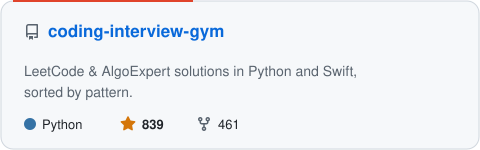
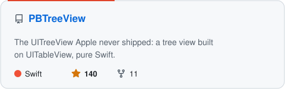
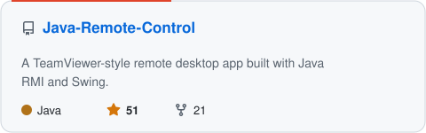
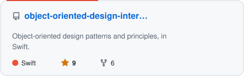

<picture>
  <source media="(prefers-color-scheme: dark)" srcset="assets/hero-dark.svg">
  
</picture>

I build mobile products end to end: the iOS, Android and React Native apps people open every day, and the
APIs, AWS services and pipelines behind them. Right now I work in mobile engineering in Amazon's Fire TV org in Berlin, on the
**[Fire TV app](https://apps.apple.com/app/amazon-fire-tv/id947984433)** that turns your phone into a remote for your TV.
Before that I was on the Mobile Foundation team at **[Zalando](https://apps.apple.com/app/zalando-fashion-shopping/id585629514)**,
building the shared platform its mobile apps run on.
My favourite system is a big, slow one, right before I make it small and fast.

## What I work on

<picture>
  <source media="(prefers-color-scheme: dark)" srcset="assets/system-dark.svg">
  
</picture>

## Impact, in numbers

<picture>
  <source media="(prefers-color-scheme: dark)" srcset="assets/impact-dark.svg">
  
</picture>

What −70% build time feels like:

<picture>
  <source media="(prefers-color-scheme: dark)" srcset="assets/race-dark.svg">
  
</picture>

## The road so far

<picture>
  <source media="(prefers-color-scheme: dark)" srcset="assets/journey-dark.svg">
  
</picture>

<b>What I shipped at each stop</b> (click to open)

 

| When | Where | In short |
|---|---|---|
| 2022 → now | **Amazon** · Mobile Engineering, Fire TV org | The Fire TV app for iOS and Android, a phone remote with **20M+ daily users**. One modular codebase for iOS, Android and web (**−70% build time**), a device-connection SDK (**80% faster**), and the GraphQL and AWS backend behind it at **99.99%** uptime. |
| 2021 → 2022 | **Zalando** · Mobile Foundation | The shared platform under Zalando's apps. Built sign-in and SSO for **80M users** across apps and web; shipped Size Profile and Subscriptions (**+15% retention**). |
| 2017 → 2020 | **Aurea Software** · Software Architect | Enterprise CRM and team-communication apps. A modular rewrite **halved app start time**. |
| 2014 → 2017 | **IPVision** · Senior Engineer | ringID, a voice, video, chat and live-streaming app, built from scratch to **5M users**. |
| 2013 → 2014 | **BizMotion** · Mobile Engineer | VoIP calling apps for iOS and Android. Built the calling SDK and cut audio delay by **20%**. |

## Open source people actually use

  <a href="https://github.com/partho-maple/coding-interview-gym"><picture><source media="(prefers-color-scheme: dark)" srcset="assets/repo-coding-interview-gym-dark.svg"></picture></a>
  <a href="https://github.com/partho-maple/PBTreeView"><picture><source media="(prefers-color-scheme: dark)" srcset="assets/repo-PBTreeView-dark.svg"></picture></a>

  <a href="https://github.com/partho-maple/Java-Remote-Control"><picture><source media="(prefers-color-scheme: dark)" srcset="assets/repo-Java-Remote-Control-dark.svg"></picture></a>
  <a href="https://github.com/partho-maple/object-oriented-design-interview-gym"><picture><source media="(prefers-color-scheme: dark)" srcset="assets/repo-object-oriented-design-interview-gym-dark.svg"></picture></a>

Plus older work with full source: real-time audio recorders, App Store apps (<a href="https://github.com/partho-maple/Backlog-Notes_Swift">Backlog Notes</a>, <a href="https://github.com/partho-maple/Task-Ticker_Obj-C">Task Ticker</a>), a contacts toolkit, a Corona SDK game and a server-side Swift API. <a href="https://github.com/partho-maple?tab=repositories">See all 58 repos →</a>

## Fun facts

<picture>
  <source media="(prefers-color-scheme: dark)" srcset="assets/terminal-dark.svg">
  
</picture>

## Toolbox

  

<picture>
  <source media="(prefers-color-scheme: dark)" srcset="assets/footer-dark.svg">
  
</picture>

&nbsp;

<!-- Assets are generated: edit scripts/build_assets.py, then run `python3 scripts/build_assets.py`. -->
